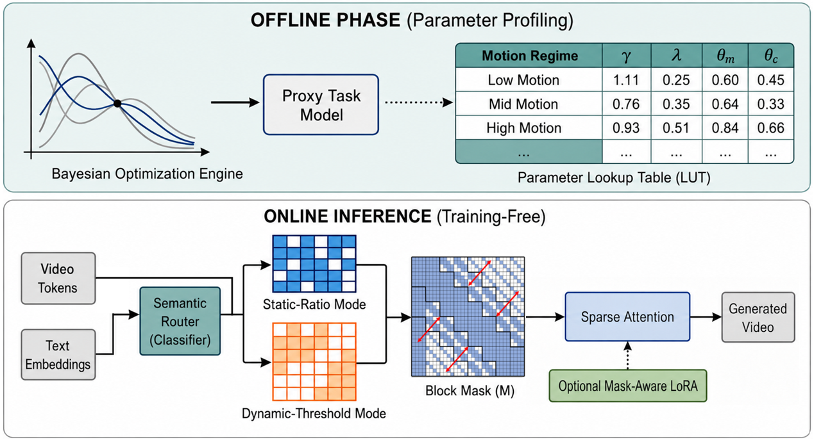

# DynamicRad: Content-Adaptive Sparse Attention for Long Video Diffusion

Yongji Long, Shijun Liang, Jintao Li, and Yun Li

NeurIPS 2026

DynamicRad uses a radial candidate set with two sparse-attention modes. `static_ratio` selects token pairs with fixed sampling ratios; `dynamic_threshold` scores the current Q/K pairs and applies normalized thresholds. The paper combines these modes with offline Bayesian optimization (BO) profiles and semantic motion routing.

## Method overview



The Wan code in this repository implements radial mask generation, sparse attention, and a Diffusers inference entrypoint. The inference command accepts a mode and its parameters directly, or reads a selected motion profile from a CSV table.

## Installation

Use a CUDA environment compatible with the selected Wan checkpoint. The dependency versions are listed in `requirements.txt`.

```bash
git clone https://github.com/Adamlong3/DynamicRad.git
cd DynamicRad
conda create -n dynamicrad python=3.12 -y
conda activate dynamicrad
pip install torch==2.5.1 torchvision==0.20.1 torchaudio==2.5.1 --index-url https://download.pytorch.org/whl/cu124
pip install -r requirements.txt
pip install flashinfer-python==0.5.1 -i https://flashinfer.ai/whl/cu124/torch2.5
```

## Wan2.1 inference

Run commands from the repository root. This example selects the dynamic-threshold mode:

```bash
python -m scripts.inference_wan \
  --model_id Wan-AI/Wan2.1-T2V-14B-Diffusers \
  --prompt "A fast-moving car crossing a city street" \
  --pattern radial --topk_mode dynamic_threshold \
  --height 768 --width 1280 --num_frames 69 --block_size 32 \
  --output_file outputs/wan_dynamic.mp4
```

The command writes an MP4 and a JSON file containing the selected configuration and generation time. Use `--topk_mode static_ratio` to select the other sparse mode, or `--pattern dense` for dense attention. Run `python -m scripts.inference_wan --help` for all parameters. The token count per frame must be divisible by the block size.

## Offline BO example

The BO script searches mask parameters on an AR feature-drift proxy using attention-weight reconstruction error and a block-sparsity target:

```bash
python -m bo_pipeline.run_bo_pipeline --steps 30
```

It writes `outputs/bo/final_bo_lookup_table_steps30.csv`, with rows for low, mid, and high motion in both sparse modes. Select a row for inference with `--profile_csv`, `--motion_regime`, and `--topk_mode`:

```bash
python -m scripts.inference_wan \
  --prompt "A fast-moving car crossing a city street" \
  --profile_csv outputs/bo/final_bo_lookup_table_steps30.csv \
  --motion_regime high --topk_mode dynamic_threshold \
  --height 768 --width 1280 --num_frames 69
```

## Code layout

```text
attention/attn_mask.py             radial masks and attention backends
bo_pipeline/run_bo_pipeline.py     AR proxy and BO profile search
models/wan2_1/                     Wan attention processor and pipeline patch
scripts/inference_wan.py           Wan inference command
```

## Acknowledgements

The project was supported by the National Natural Science Foundation of China (Grant No. W2431044). We thank the developers of Wan2.1, FlashInfer, and Radial Attention for their open-source work.
